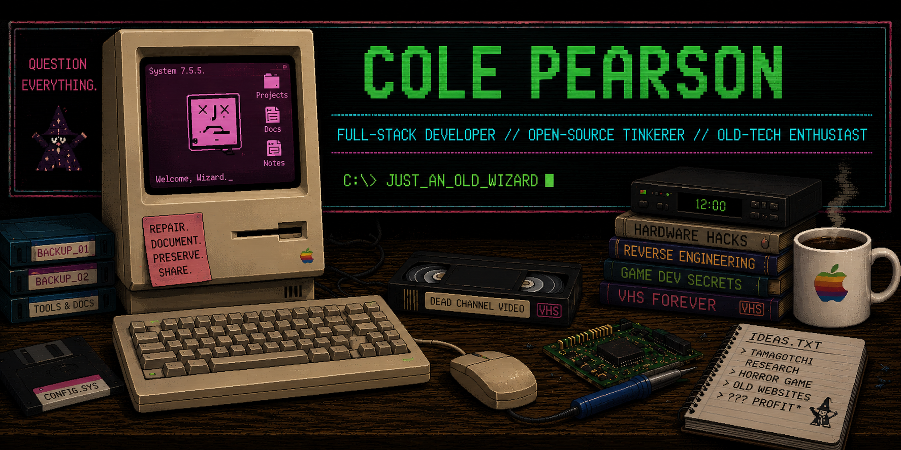

  

# Hey, I'm Cole. 👋

**Full-stack developer · Open-source tinkerer · Old-tech enthusiast**

I build things for the web and spend an arguably unreasonable amount of my
free time messing with old hardware, dead media, games, preservation,
reverse engineering, and whatever other rabbit hole I've fallen into lately.

> *Just an Old Wizard.*

---

## 🔧 What I Do

Most of my professional work lives in full-stack web development — building,
maintaining, debugging, and occasionally convincing complicated systems to
behave themselves.

Outside of work, I'm usually building something of my own. I have a particular
soft spot for projects that combine software with old hardware, preservation,
reverse engineering, strange technology, or things the internet has mostly
forgotten about.

### Languages & Web

`PHP` · `JavaScript` · `TypeScript` · `HTML` · `CSS` · `SQL`

### Frameworks, Platforms & Tools

`WordPress` · `Astro` · `Next.js` · `React` · `React Native` · `Node.js` · `PostgreSQL` · `Git` · `GitHub` · `Godot`

### Currently Exploring

`Reverse Engineering` · `Hardware Preservation` · `Game Development`
· `Retro Computing` · `Firmware Research`

---

## 🗃️ Featured Project — CacheLore

### Object Intelligence. Identify, catalog, and understand what you found.

**[CacheLore](https://cachelore.com)** is an object-intelligence platform I'm
building to identify exact physical collectibles, explore their history, and
organize collections using traceable source evidence rather than guesswork.

The work spans:

- **CacheOS 97:** A late-90s-inspired web workstation for object research, catalog exploration, and private collection management.
- **PT—01 Pocket Terminal:** A React Native / Expo field-inspection client, currently in active development.
- **Data & infrastructure:** A PostgreSQL-backed catalog, provenance-aware domain models, authentication, APIs, and a Next.js / TypeScript web app.

**Status:** Active development; the source repository is private. Data coverage and product capabilities continue to evolve.  
🌐 **Website:** [cachelore.com](https://cachelore.com)  
🛠️ **Built with:** Next.js · TypeScript · PostgreSQL · React Native · Expo

### Other Projects

#### 🧰 [Pixel & Stack](https://pixel-and-stack.com/)

**Pixel & Stack** is my independent software and web consultancy, focused on
building, improving, and maintaining the websites and systems businesses rely on.
That includes full-stack development, custom internal tools, API integrations,
infrastructure, troubleshooting, and long-term production support.

🌐 **Website:** [pixel-and-stack.com](https://pixel-and-stack.com/)

#### [Signalbox](https://itscol.es/projects/signalbox/)

**Signalbox** — A modern open-source terminal client for Pandora, carrying
pianobar's native-C foundation into a responsive TUI for macOS and Linux, with
a native Windows build in active development.

#### 📼 [PLEASE REWIND: A Dead Channel Video Story](https://itscol.es/projects/#please-rewind)

**PLEASE REWIND** is an independent 3D horror game set in the strange world
of a fictional 1990s video store. I'm building it in Godot 4, from gameplay
and state systems to interactive environments, UI, tooling, and performance work.

🎮 **Built with:** Godot 4 · GDScript · 3D game systems  
🚧 **Status:** In development; source repository is private.  
🌐 **Project:** [itscol.es/projects/#please-rewind](https://itscol.es/projects/#please-rewind)

#### 🥚 [TamaMedics](https://tamamedics.com)

*Repair it. Document it. Preserve it. Share it.*

**TamaMedics** is an open-source, community-oriented
project dedicated to Tamagotchi repair, hardware preservation, reverse
engineering, firmware research, documentation, and tooling.

Current research includes the **Tamagotchi Plus Color**, with work focused on
safe firmware dumping, hardware research, emulator-assisted analysis,
translation, and English patch development.

🔬 **Research:** Tamagotchi Plus Color English Firmware  
🛠️ **Built with:** Astro · TypeScript · MDX · CSS  
🌐 **Website:** [tamamedics.com](https://tamamedics.com)  
📦 **Repository:** [github.com/simplycole/tamamedics.com](https://github.com/simplycole/tamamedics.com)

---

## 📼 Elsewhere in the Lab

I'm interested in the weird intersection between modern software and
obsolete technology.

That tends to involve:

- 📼 VHS, dead media & analog technology
- 🖥️ Retro computers & hardware
- 🔬 Reverse engineering & preservation
- 🎮 Game development
- 🌐 Web development
- 👻 Horror
- 🎲 Tabletop gaming
- 🧙 Magic: The Gathering
- 🐇 Questionable technological rabbit holes

There is usually at least one half-disassembled piece of electronics nearby.

---

## 🌎 Find Me Elsewhere

🌐 **Web:** [itscol.es](https://itscol.es)  
💼 **LinkedIn:** [linkedin.com/in/simplycole](https://linkedin.com/in/simplycole)  

---

Probably taking something apart that was working perfectly fine five minutes ago.
